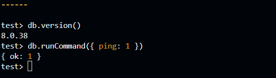

# MongoDB Setup

MongoDB Community Server runs locally in the existing Ubuntu 24.04 GitHub Codespace, alongside PostgreSQL, for the Digital Banking Platform project.

The installed MongoDB Server version is **8.0.38**, and the MongoDB Shell (`mongosh`) version is **2.14.2**.

The MongoDB data directory is `/workspaces/mongodb-data`, located outside the Git repository. This keeps database files separate from the project source files.

The MongoDB server listens on `127.0.0.1` (localhost) on port `27017`. The Codespaces port visibility is set to **Private**, preventing public access to the forwarded port.

## Start and Connect

The MongoDB server was started in the background using:

```bash
mongod --dbpath /workspaces/mongodb-data --logpath /workspaces/mongodb-data/mongod.log --logappend --bind_ip 127.0.0.1 --fork
```

The MongoDB Shell was used to connect to the local server:

```bash
mongosh "mongodb://127.0.0.1:27017"
```

## Connection Check

The MongoDB connection was tested successfully using the following command inside `mongosh`:

```javascript
db.version()
```

The command returned:

```text
8.0.38
```

The server connection was also tested using:

```javascript
db.runCommand({ ping: 1 })
```

The command returned:

```javascript
{ ok: 1 }
```

These results confirm that the MongoDB server was running and responding to database commands successfully.



## Reference

[MongoDB Community Server installation guide for Ubuntu](https://www.mongodb.com/docs/v8.0/tutorial/install-mongodb-on-ubuntu/)
